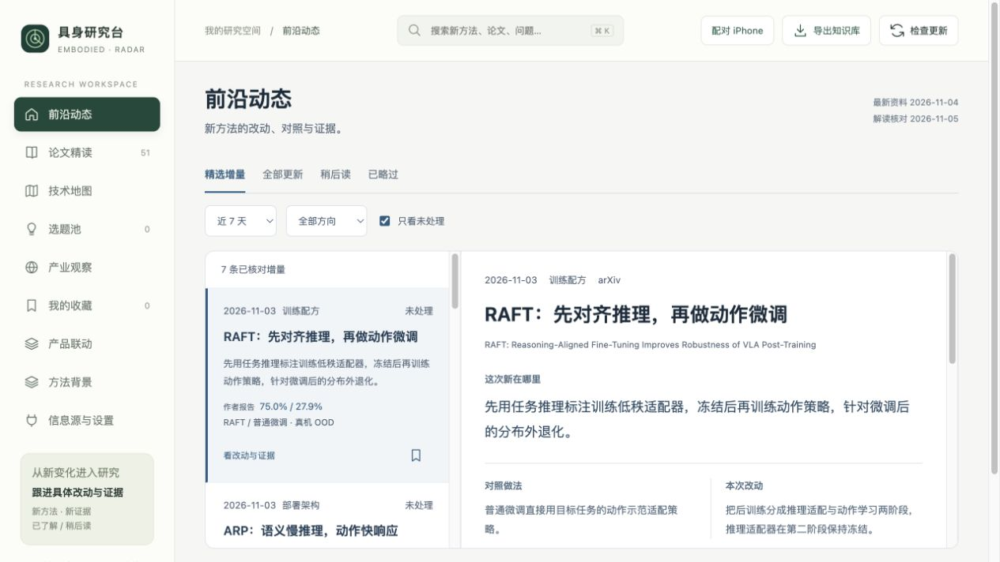
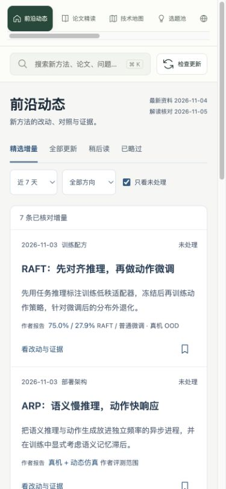
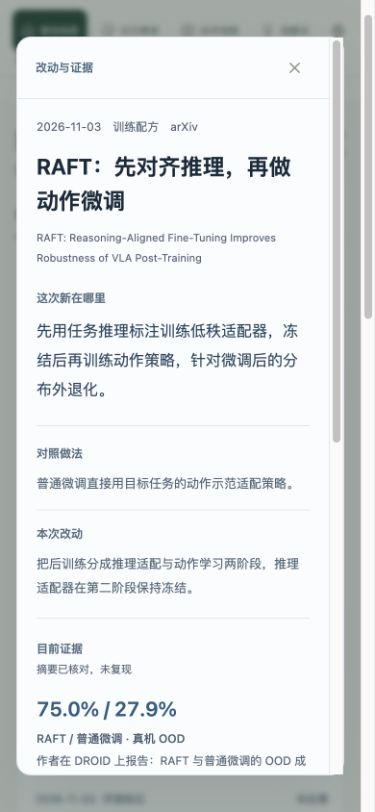

# 前沿阅读流程复核

2026-11-05，按 Product Design audit skill 执行。目标是判断研究者能否直接读到新方法的增量，再按兴趣深入。本轮新捕获并逐张检查截图，使用本机网页，不包含原生 iPhone 验收。

1. **桌面入口：通过。** 具体进展、日期、对照和改动直接呈现。证据详情需要继续滚动，建议后续把处理与精读操作汇总到固定区域。

2. **手机入口：已修复。** 375px 无横向溢出；原单行标题触控高度约 28px，现为 44px。书签名称已加入对应论文标题。桌面键盘切换后保留焦点，并提供当前条目的语义标记。

3. **改动与证据详情：通过。** 点击标题可进入；新改动、对照、作者证据和核对层级按顺序显示。处理动作仍位于正文末端，待与未来精读队列一起统一工具区。

## 可确认与待检查

- 已确认标题点击区域、命名、键盘切换焦点，以及当前页面与详情的关联。
- 仅凭截图不能确认所有对比度、VoiceOver、200% 字级、焦点锁定或 iPhone 真机表现。
- 复核不代表研究结论已复现，也没有启用自动 GPT 精读。
- 完整逐步记录：[notes.md](notes.md)。自动精读方案：[automatic-reading.md](../../automatic-reading.md)。
