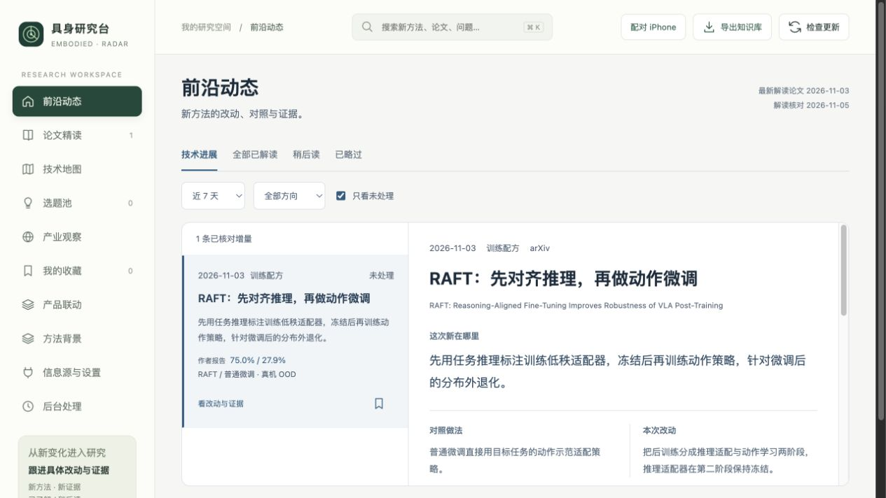
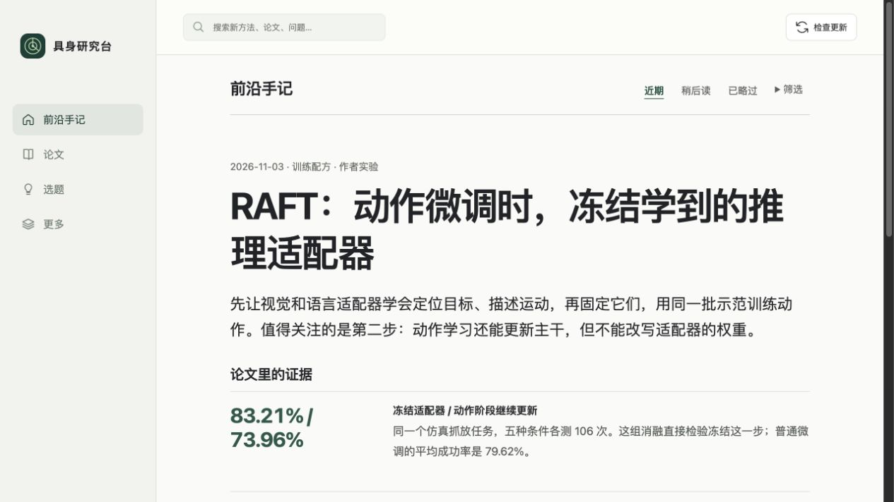

# 阅读与应用动线复核

本轮参照苹果的系统字体、文字层级和稳定导航原则，采用内容优先的阅读页面。参考 [Typography](https://developer.apple.com/design/human-interface-guidelines/typography) 与 [Navigation and search](https://developer.apple.com/design/human-interface-guidelines/navigation-and-search)。目标是让有领域基础的读者先理解可复用的技术选择，接着查看实验依据，再形成自己的验证计划。

1. 首页原有重复的左右栏标题与摘要，筛选先于正文，次要工具与阅读并列。当前改为单篇连续阅读、四项主导航，筛选折叠。默认展示全部时间的已精读内容，论文日期明确显示。新论文按来源更新日期排序。健康状态为通过。
2. 方法理解原先强调两组真机成绩。当前优先展示冻结与继续更新适配器的直接消融，随后解释样本量、对照和额外训练成本。其他实验结果、训练细节、论文信息按需展开。健康状态为通过。
3. 实验草稿原先需要经过论文笔记入口。当前正文可以直接带入问题、原文出处、证据和待验证实验建议，编辑后保存到选题池。使用隔离数据库实际保存并在选题页确认内容。正式服务的草稿入口与取消也已检查。健康状态为通过。
4. 手机网页改用底部四项导航，实测390px无横向溢出，导航目标52px。原生App同步四项导航、问题草稿入口，并内置已精读论文与对应原文片段供首次离线阅读。网页健康状态为通过，原生真机显示与系统键盘待验收。

改版前截图

改版后的桌面阅读

改版后的手机阅读与实验草稿

网页实际检查覆盖正文、筛选、导航、草稿填充、隔离保存与选题查看。核心回归测试通过，iOS两种目标编译通过。截图不能证明完整无障碍合规，iPhone真机、VoiceOver、实际键盘和大字体仍需现场验收。
