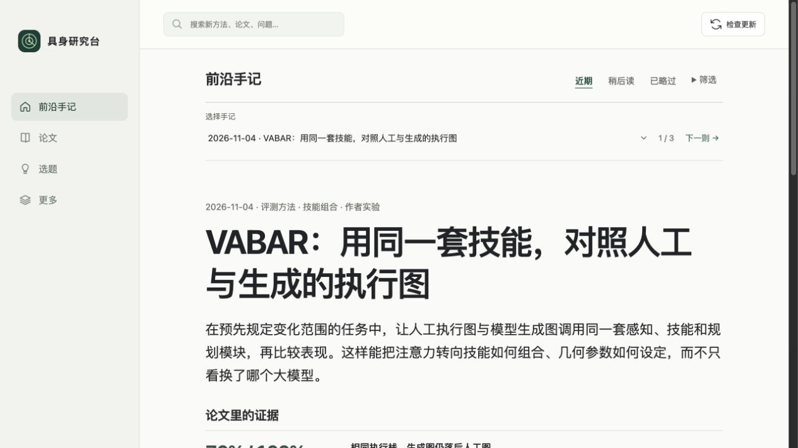
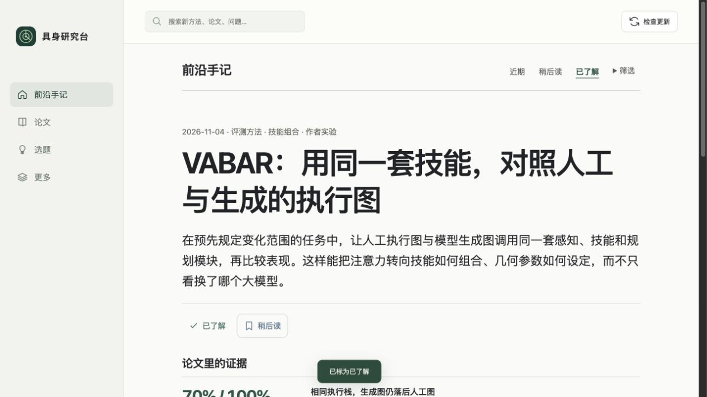
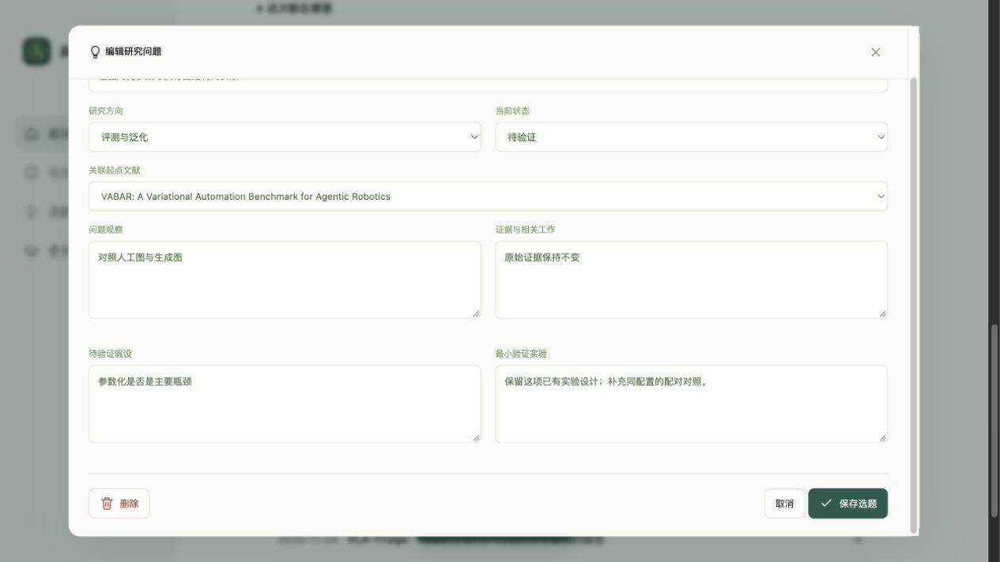
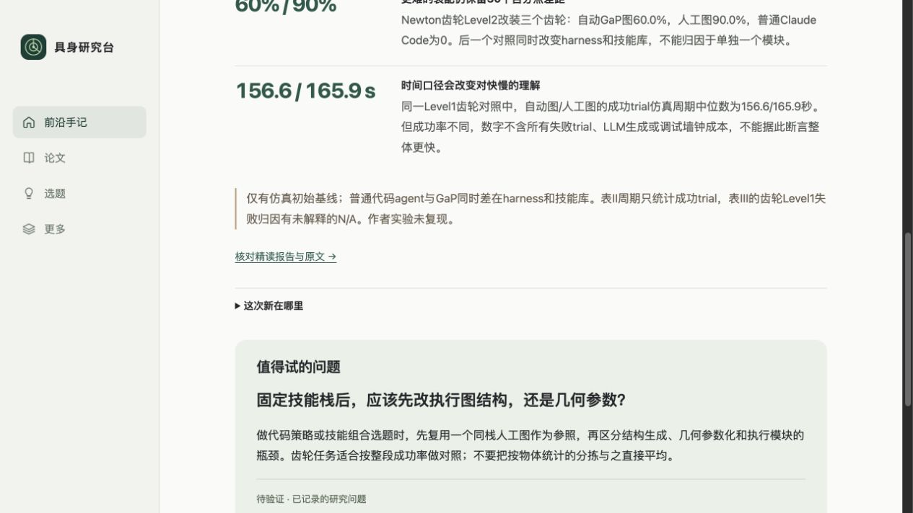
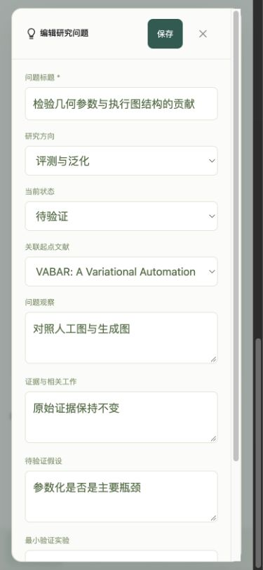
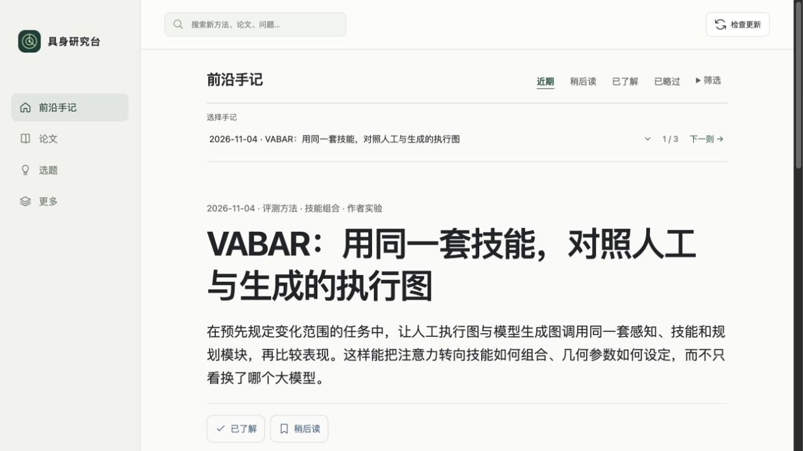

# 回看与研究续写动线检查

2026-11-05。目标：学习一项新方法后，可以回来核对证据、继续自己的验证计划。正式服务为8765；涉及个人状态与保存的操作全部在8771的隔离测试库中进行。

基线：原页面只有近期、稍后读、已略过；已了解的内容没有专门入口。文章地址不含论文标识，进入报告后的返回链接指向首页。已有实验仍只显示创建按钮。

1. **已了解回看：通过。** 在隔离库中标记一篇为已了解，进入对应视图，论文可见；日期筛选不会把旧的已了解方法隐藏。标记不改变论文已读状态或笔记。按钮至少44px，状态有文字。VoiceOver完整行为仍未测。

   
   

2. **继续已有实验：通过。** 从手记打开已有计划，修改并保存，再次打开仍是同一ID，数据库仍只有一条计划。原文证据保留。测试记录是隔离数据，没有写入个人选题库；用户需主动保存才更新实验。

   

3. **原文返回与页面历史：通过。** 报告返回链接包含论文及视图；返回后仍为VABAR、已了解视图，证据展开状态保留，阅读位置恢复至934px。正式服务另外验证了RAFT刷新后保持同篇、浏览器返回恢复VABAR。阅读位置只保存在本页会话的浏览器存储，按论文内容版本区分，不存个人研究文本。跨设备和跨标签页不保证同一位置。

   

4. **手机编辑与保存：网页检查通过，iOS真机待验收。** 390×844下未出现横向溢出。编辑页顶部保存按钮44px，实际保存成功；输入框16px。按钮固定在可见标题栏，无需滚动到长表单底部。未连接真实iPhone，系统键盘遮挡、动态字体和VoiceOver不能仅凭截图确认。

   

正式版本已更新；下图不包含隔离库里的实验与处理状态。

验证：Python65项、网页23项、Swift7项，共95项通过。iPhone Release及Simulator Debug不签名构建通过。iOS补齐已了解视图、视图偏好保留、关联实验入口，并过滤技术地图中的未精读论文。内置公开资源现为6篇背景文献及3篇精读论文；软件包不包含测试库或个人数据。
