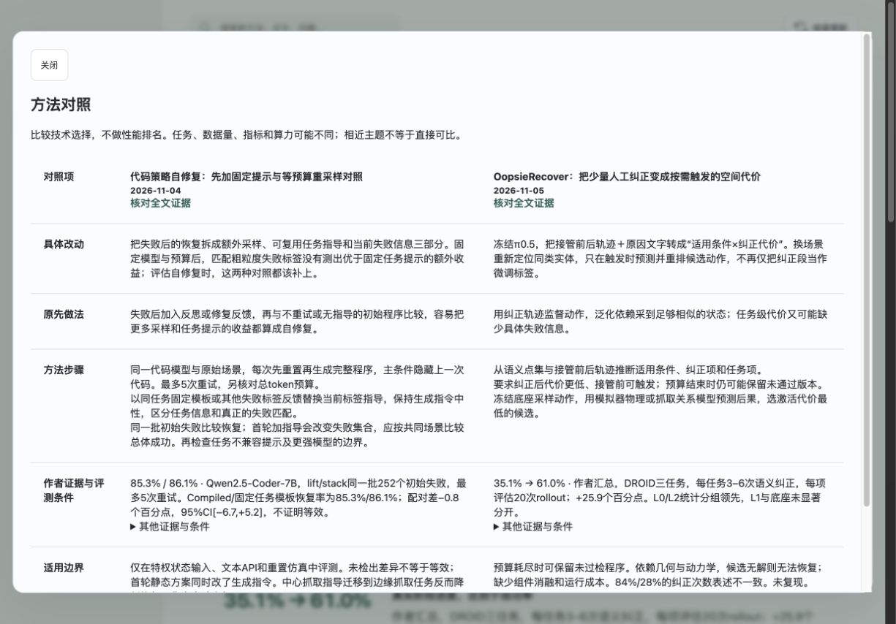

# 精读、手机内容与方法工具更新

2026-11-06。按用户选定顺序实现精读优先级、原文失败恢复、手机全文同步、方法对照与复用入口，已更新本机常驻运行副本。

## 已实现

- 精读领取统一比较待准备和已准备候选。最新日期优先，同日按关注主题与方法/综述类型排序，并公开候选顺序和原因；这是可解释的调度规则，不是论文质量评分。不丢弃候选，不修改收藏、已读或个人选题。按arXiv标识和版本保留现有幂等登记；没有假装实现语义级去重。
- PDF采用流式下载，128 MiB上限、总体时间及单次请求超时、原子完成文件和不完整下载清理。原文提取失败保留固定版本PDF，重试复用原文件。网络错误有界重试，过大/不可读等永久错误一次停下并说明原因。准备租约调整为300秒，覆盖下载与提取预算；代理30分钟租约保持不变。
- PDFKit文本不足的页可尝试Apple Vision本机OCR，不调用模型API；OCR片段标明来源和需核对。仍有不可读页则阻止准备成功，不把残缺内容当完整证据。OCR不保证公式、表格或图片语义正确，后续代理仍需核对关键原图。[Apple文字识别接口](https://developer.apple.com/documentation/vision/vnrecognizetextrequest)。
- Cosmos 2611.06627此前因30 MiB限制失败，本轮按现有重试协议恢复，约49.8 MB PDF下载与提取成功，当前ready_for_agent。它仍未完成精读，没有进入前台。
- 新增受现有访问控制保护的GET /api/content/manifest与GET /api/content。内容包只含当前版本已通过展示检查的公开手记、报告与原文，版本覆盖整个内容；不导出个人笔记、收藏、处理状态、选题、设置或租约。原RAFT使用已验证的版本匹配编辑卡时，下载副本携带该卡供离线展示，不改原报告。
- iOS刷新资料后自动检查内容版本，校验来源document_id与全文覆盖后缓存全部已发布精读；不必先逐篇打开。下载未完成保留旧缓存和草稿，显示全文待重试提示。连接横幅显示可离线精读数，设置显示上次全文更新时间。仍按服务器分区保存，现有冲突核查与操作去重保留。PDF附件仍需单独下载。
- App内置公开快照由3篇更新至10篇，包含完整报告和文字证据；构建脚本支持PDF来源且按同一论文版本去重。此数字是本轮内容状态，后续以内容manifest为准；不代表已安装到用户iPhone。
- 网页支持选2–3篇已发布论文，按改动、原做法、步骤、作者证据条件、边界和采纳前检查对照；不计算跨任务性能排名。桌面并排，390px手机宽度按项目纵向排布。较长证据和检查按需展开。选择只在当前浏览器会话保存公开论文ID，返回全文后可继续对照。
- 网页和原生端新增“怎样用于我的研究”，仅重组当前版本已有引用的方法步骤及限制，不编造缺失的代码、数据、硬件或科学结论。网页可直接打开对应原文片段。验证实验仍由用户点击起草，不自动创建或覆盖研究内容。原生端有方法对照选择页与详情入口。

## 验证

- Python共72项通过，包括有界下载清理、缓存重试、永久错误、跨准备状态优先级、公开包隐私与新版失效、登录访问控制，以及既有笔记/选题冲突和展示检查。
- JavaScript共26项通过，包括两篇对照、只允许已发布内容、来源转义、复用不自动写选题，以及证据链接定位。
- Swift核心8项通过，包括完整内容包、混合版本拒绝、覆盖不足拒绝，以及旧缓存与草稿兼容。
- iOS Simulator Debug与iPhone arm64 Release无签名构建通过。
- 真实运行服务的manifest与完整包一致，当前10篇；每篇document_id与覆盖数一致。
- 用论文公开页图像生成无文字层PDF样本，OCR识别1/1页、5710字符、无未识别页。仅证明这份样本流程可用，不是通用识别准确率评测。
- Chrome实际走通选择论文、切换、打开对照、关闭、展开复用步骤与跳转全文。在390×844测试移动排布后已恢复默认视口。内置浏览器控制仍不可用，因此使用已存在的Chrome研究台标签页；控制台仅见Zotero扩展通信错误，未见本次页面脚本错误。

## 截图

## 保留边界

没有新增定时任务、另付费模型调用或公网部署；每3小时一篇的节奏不变，优先级不会自动消除处理量瓶颈。定时精读继续使用专用会话与原有提交协议。

目前没有连接用户iPhone，也没有可用的已启动模拟器设备；已完成构建及核心逻辑检查，但未完成原生触控、系统权限、动态字体、VoiceOver和实际断网/恢复验收。新客户端功能需安装本轮构建后生效。跨校园网/外网访问、Mac睡眠后的持续执行仍未解决；本轮内容同步要求手机可以连接研究台。

多篇方法工具展示已精读证据的对照，不等于已经完成系统综述、复现或证明某个研究空白。产业发布专用核查流程、语义级候选去重和更深的结构化复用配方留在后续任务。
