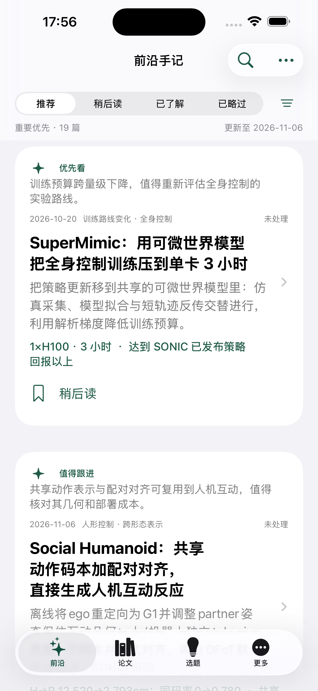
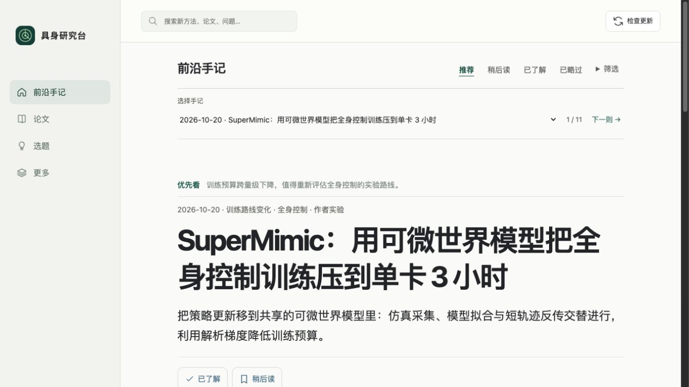

# SuperMimic 漏收与重要性优先修复

## 原因

检查时数据库没有 SuperMimic，也没有相应精读任务。原 arXiv 查询每次只取最新 45 篇，没有历史回扫；关键词也没有明确覆盖 humanoid、whole-body、locomotion。精读和推荐主要按日期排序，因此较早的重要研究没有及时进入候选与首屏。

## 本轮完成

1. 补收 SuperMimic，按队列领取固定版本，完整精读 19 页并核对图表。报告、逐字引用与技术增量卡通过展示检查，发布日期保留 2026-10-20。
2. arXiv 每次获取近期 100 篇，并轮转回扫过去 30 天的 200 篇；扩大全身控制等关键词，加入可配置关键论文版本追踪。失败或 RSS 降级会明确报告覆盖缺口，不宣称完整采集。
3. 精读前新增最多 24 篇公开摘要初筛，兼顾新论文、邻近方向及轮换较早候选；初筛理由需引用标题/摘要原文，只调整阅读顺序，不能直接发布。
4. 精读后新增 importance/attention 判断，区分 priority、notable、routine；高优先等级必须同时关联已核对的方法和实验证据。版本匹配的补充评估独立于原报告保存，不覆盖原有解读。
5. 复核现有 19 篇公开精读卡片的方法、实验证据与边界，补齐阅读优先级；不是仅给 SuperMimic 写死一个首页位置。旧版本或没有评估的其他内容仍明确保留未评估状态。
6. 网页与 iOS 默认按重要性优先，同等级再按日期；卡片直接说明优先阅读理由。已了解或略过不继续占据重要推荐位；明确时间、方向和搜索筛选仍生效。网页保留其他手记的阅读位置时，会在上方提供重要条目入口。
7. 公共内容包采用独立且确定的顺序，避免个人已了解/略过通过包顺序或版本指纹间接导出。

## 已验证

- SuperMimic 81/81 原文片段，方法与实验证据引用检查通过；没有绕过全文展示门槛。
- 真实 arXiv 回扫返回 301 篇、包含 SuperMimic，未出现覆盖警告。实际部署服务随后也完成 arXiv 301、GitHub 两源各 5、LeRobot 模型 10、机构博客 12 条的采集。
- 本机与带访问码的公网 HTTPS 接口确认首条为 SuperMimic / priority，随后为 notable 研究；日期保持真实。
- 网页实际验收了首条推荐、优先理由，以及切换到其他论文时保留重要入口。没有改变用户个人处理状态。
- 原生 iPhone 15 Pro Max / iOS 26.4 模拟器确认首屏第一条为 SuperMimic，下一条有独立的“值得跟进”理由。使用正式项目的内置公开快照，未注入假论文。
- 模拟器 Debug 和 iPhone arm64 Release 无签名构建通过，构建号 1.0（4）。
- 最终 Python 84 项、JavaScript 29 项、Swift 核心 10 项测试通过；覆盖较早重要研究优先、已了解后的降序、明确筛选仍生效、版本绑定初筛、采集回扫及公共内容包不泄露个人处理状态。

截图：

## 边界

阅读优先级属于有出处的编辑判断，不是科学质量定论或独立复现结论。初筛不能保证识别所有重要研究；现有执行频率仍是每三小时处理一篇，未增加付费 API、额外定时任务或系统通知服务。重要性复核不会把原论文作者的宣传词直接升级为已证实突破。

当前内置公开资源有 19 篇，在线前台仅展示当前来源版本已通过检查的报告，数量可能因论文修订而不同。未完成精读的候选继续留在后台。

公网仍采用 Mac 在线时可用的临时通道，重载后地址会变化，当前入口以本机 `/pair` 为准。本轮最终 HTTPS 验证已通过。用户 iPhone 当前不可用，尚未安装 1.0（4），没有将模拟器截图称为用户真机实测。
