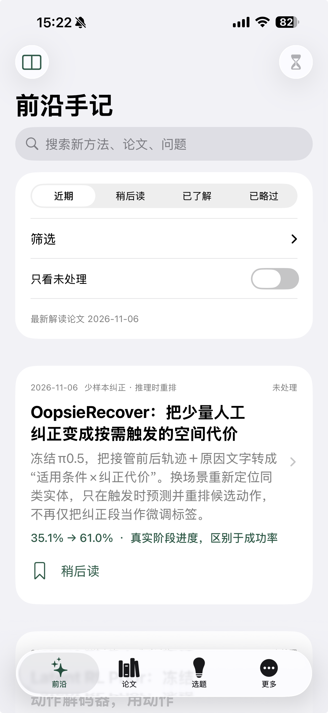
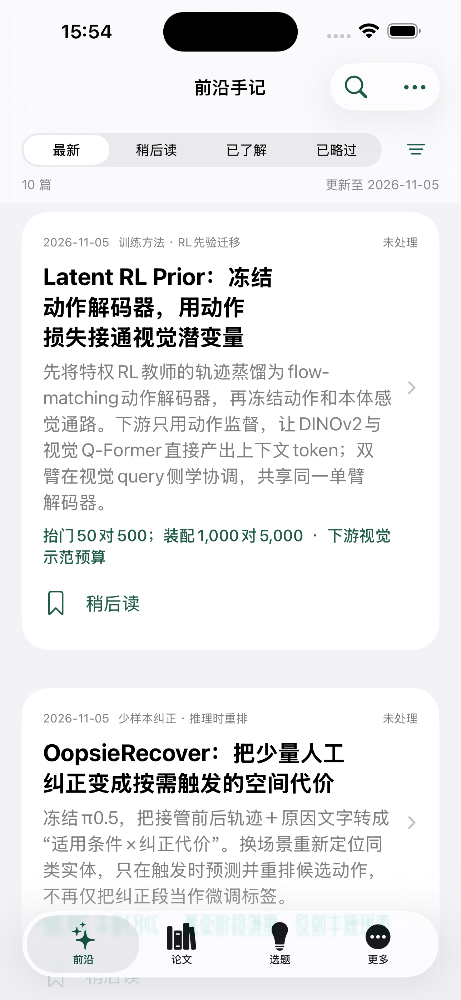
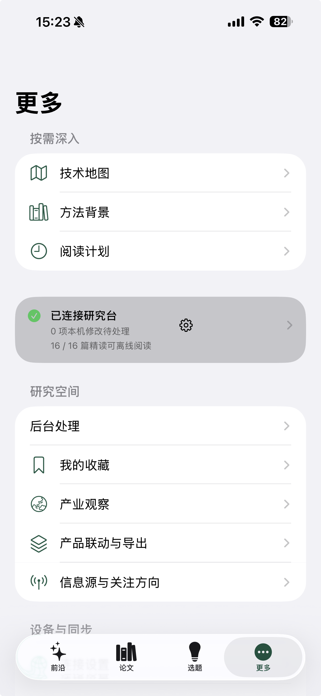
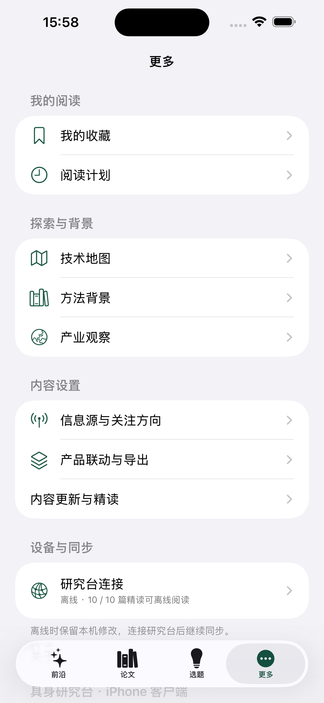

# 前沿首页与“更多”信息层级改版

## 目标与依据

保留既有原生 SwiftUI 界面和阅读状态，把首页让给具体研究方法，统一“更多”中的设置层级。本轮依据用户提供并明确要求修改的两张真机截图，已逐一打开核对并保存原图副本；不是基于旧浏览器截图推断原生界面。

1. [前沿首页原图](01-frontier-before.png)：阅读卡片直到屏幕中部才出现；大标题、常驻搜索和包含四行内容的筛选卡叠加，首屏操作成本高。状态分组、筛选和元信息本身有用，位置和占用需要调整。
2. [更多页原图](02-more-before.png)：阅读导航中间插入独立灰色连接卡，之后又重复“连接设置”。连接卡中的齿轮和行箭头形成多个操作暗示，设备信息与阅读入口混排。

## 已实现

### 前沿首页

- 使用行内标题，移除原有整块筛选卡与常驻搜索栏；首页从论文列表开始。
- 顶部保留一行“最新 / 稍后读 / 已了解 / 已略过”，旁边是筛选按钮。摘要只占一行，给出当前范围、篇数和内容日期。
- 点放大镜才展开搜索输入；关闭后恢复阅读空间。搜索仍使用原有题名、方法与问题匹配逻辑。
- 时间、方向、未处理选项放入原生筛选面板，提供重置与完成；按钮显示启用数量，摘要显示实际条件。
- 方法对照和手动更新移入“更多阅读操作”，保留下拉更新。
- 辅助功能大字号时分组控件改为菜单，避免四段文字挤压。筛选与搜索操作有明确辅助标签。

### 更多

- 也采用行内标题，避免大标题将设备连接行挤到标签栏附近。
- “我的阅读”：收藏、阅读计划。
- “探索与背景”：技术地图、方法背景、产业观察。
- “内容设置”：来源与关注、联动与导出、内容更新与精读。
- “设备与同步”：仅一个标准列表式“研究台连接”，行内显示连接状态和离线精读数量；有待同步修改或冲突时显示相应操作。
- 移除中间的独立连接卡和内嵌齿轮，连接入口、状态与同步操作归到同一组。
- 关于页版本来自应用包，当前构建号为 3。

## 验证与限制

- 模拟器 Debug 与 iPhone arm64 Release 无签名构建通过。
- Swift 核心 9 项、JavaScript 28 项测试通过。没有改动论文发布门槛、个人笔记、草稿分区或同步协议。
- 默认模拟器设备目录指向外置盘，创建失败。已在独立目录 `~/Library/Developer/ResearchRadarSimulatorDevices` 创建并启动 iPhone 15 Pro Max 验证设备，应用已安装并启动；没有移动或清空原有模拟器数据。
- 用户随后明确允许使用 Xcode 自带 simctl 截图。现已获取并逐张打开原生截图，核对普通字号前沿、更多、搜索展开、筛选面板、辅助功能大字号与前沿深色模式。普通字号下，首条内容从原图约屏幕 51% 处移到约 21% 处；首屏露出第二条标题。更多中的设备连接行完整显示在标签栏上方，样式与其他设置一致。
- 截图设备为 iPhone 15 Pro Max / iOS 26.4，与用户手机同型号。原生产品构建直接截图用于前沿首页；另建 `/tmp/radar-layout-qa` 验收副本，仅允许预置初始 Tab 与搜索/筛选面板状态，业务视图和布局不作替换。这些启动辅助没有加入正式项目，也没有安装到用户手机。截图证明显示状态，不能代替真实触摸操作、键盘输入或 VoiceOver 验收。
- 工具拒绝访问 Terminal 与 SecurityAgent，未操作这些应用。真机签名构建停留在 codesign 阶段，已取消本轮等待，保留两个平台的编译产物；未声称签名完成。
- 真机当前不可用，新版尚未安装到用户 iPhone。VoiceOver、真实触摸、键盘输入与签名安装仍待真机检查。模拟器使用内置公开快照，与用户截图中的在线 16 篇内容不同，因此对比针对页面布局，不比较论文数量或发布日期。

## 截图对照与检查步骤

| 前沿：调整前 | 前沿：调整后 |
| --- | --- |
|  |  |

| 更多：调整前 | 更多：调整后 |
| --- | --- |
|  |  |

1. 前沿默认态：显示检查通过。筛选控制不再占用一张大卡，方法内容明显提前。
2. 更多默认态：显示检查通过。阅读、探索、内容设置、设备同步分组明确，只有一个设备连接入口。
3. [筛选面板](05-filters.png)：显示检查通过。时间、方向、未处理与重置均可见；没有把初始展开截图当成真实按钮点击验证。
4. [辅助功能大字号](06-frontier-large-text.png)：显示检查通过。分组改用菜单，标题与内容换行显示；不代表完整辅助功能合规。
5. [搜索展开](07-search-expanded.png)：显示检查通过。输入栏按需出现，关闭操作明确；键盘输入尚待实测。
6. [前沿深色模式](08-frontier-dark.png)：显示检查通过。系统背景、卡片和强调色正常切换。

## 实现位置

`ios/ResearchRadar/Sources/FrontierViews.swift`、`ios/ResearchRadar/Sources/WorkspaceViews.swift`、`ios/ResearchRadar.xcodeproj/project.pbxproj`。
